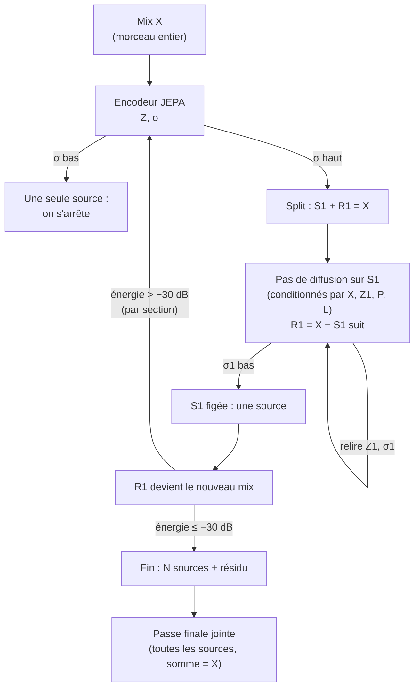
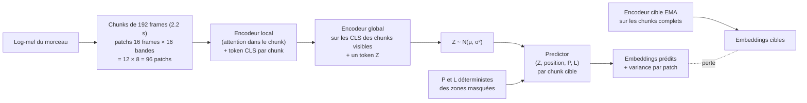

# Cleave : séparer un morceau en fendant ses sources une à une

*Note de conception, 15 octobre 2026, branche `lab/cleave`. Rien n'est encore entraîné : ce document fixe
ce qu'on construit, pourquoi, et comment on saura si ça marche. Le code de la phase 1 est dans
`src/priism/lab/cleave/`.*

*Cliver* une gemme, c'est la fendre en deux le long de ses plans naturels. Cleave fait la même chose à un
morceau : il en détache une source, puis la suivante, jusqu'à ce que le reste soit vide. Il s'inscrit dans la
même famille que Facet, qui sépare à partir des stems de BS-Roformer-SW regroupés par identité.

---

## En bref

- **Le but** : séparer un morceau en autant de pistes qu'il a de sources, sans connaître ce nombre, en
  restant dans le cadre Z / P / L / V du lab (Z = identité et timbre, P = notes et onsets, L = loudness,
  V = placement et mix).
- **L'idée** : un encodeur lit le morceau entier et donne une identité Z avec son incertitude σ. Si σ est
  grand, il y a plusieurs sources. On *épluche* alors la plus forte par diffusion. Le reste (mix moins la
  source) devient le nouveau morceau, et on recommence jusqu'à ce que le résidu soit à moins de 30 dB.
- **Phase 1, celle de ce document** : entraîner l'encodeur, un JEPA self-supervised qui apprend Z et σ.
  Il voit d'abord des pistes à un seul instrument, puis des mélanges de plus en plus riches. On vérifie
  pendant l'entraînement si σ monte vraiment avec le nombre de sources.
- **Pourquoi maintenant** : le step 3a de Facet montre que le goulot est l'*assignation* (qui appartient à
  quelle source), pas le *comptage*. Facet obtient 2.85 dB, Facet avec le vrai nombre de sources 3.00 dB
  (+0.15, n.s.), l'oracle 4.65 dB. Cleave remplace le clustering par une extraction générative guidée par
  un prior « à quoi ressemble *une* source ».

---

## 1. La vision complète

**L'état** est une chaîne de sources figées S1 … Sk et un résidu R. La somme vaut toujours X par
construction. C'est l'invariant de l'engine (`input = outputs + rest`), et la contrainte du contrat MyMixxx
(les stems plus le résidu font le morceau) est garantie sans effort.

**Une étape** :
1. On calcule (Z, σ) sur le résidu courant. Si σ est bas, le résidu est une seule source et on s'arrête.
2. **Split** : un nœud S1 et un résidu R1 = X − S1.
3. **Diffusion** sur S1, conditionnée par le mix, par P et L recalculés sur le nœud, et par Z1. Le résidu
   n'a pas de diffusion propre : il est déterministe, et il hérite des erreurs de S1.
4. À chaque pas, on relit (Z1, σ1) = encodeur(S1). Quand σ1 est assez bas, S1 est figée.

**Deux critères d'arrêt.** σ dit « ce nœud est une seule source ». L'énergie du résidu dit « il ne reste
rien à chercher » : moins de 30 dB sous le mix, mesuré **par section** et non sur tout le morceau, sinon un
instrument présent seulement dans l'intro disparaît. Un résidu faible avec un σ bas est peut-être un stem
« ambiance » légitime (reverb, room) plutôt que du déchet.

### Choix déjà faits

- **Z se lit, il ne pilote pas** (au moins au début) : la diffusion extrait la source dominante, et Z sert
  à décider l'arrêt et à nommer la source. Piloter la diffusion avec un Z échantillonné obligerait à tirer
  Z dans une loi à plusieurs pics (deux instruments = deux pics). Un tirage dans une seule Gaussienne
  large tomberait *entre* les deux, sur un timbre qui n'existe pas.
- **« Le plus fort » est un biais, pas une règle.** Quand deux sources ont à peu près la même énergie, une
  règle stricte fait sauter la cible d'un exemple à l'autre. On demande d'extraire « une source », avec
  l'énergie comme préférence.
- **Le contexte est le morceau entier pour Z, le signal est reconstruit par chunk.** L'identité se décide
  globalement. La diffusion travaille localement, ce qui la rend abordable.

### Les risques connus

| Risque | Réponse prévue |
|---|---|
| Une chaîne gloutonne propage ses erreurs. La recursive separation en parole (OR-PIT) tient sur 2 à 4 locuteurs, un morceau a 10 à 20 sources. | Passe finale jointe sur toutes les sources avec la contrainte de somme, façon Multi-Source Diffusion ou EM. |
| Point fixe trompeur : kick + basse fusionnés, que l'encodeur juge homogènes, donc σ bas. | σ doit avoir vu des paires difficiles (même registre, même rôle) étiquetées « plusieurs sources ». |
| Coût : diffusion × nombre de sources × nombre de pas sur un morceau entier. | Diffusion par chunk conditionnée par Z global ; diffusion en latent ; GPU obligatoire pour la séparation. |
| σ ne mesure pas ce qu'on croit (section 2.8). | C'est l'objet du test de la phase 1. |

---

## 2. Phase 1 : le JEPA qui donne Z et σ

### 2.1 Représentation

Log-mel à 44.1 kHz, `n_fft` 2048, hop 512 (86 frames/s), 128 bandes de 20 Hz à 16 kHz, en mono (V et la
stéréo viendront plus tard). Le niveau absolu est conservé : L en dépend, et un gain aléatoire par stem
sert d'augmentation.

Un morceau de 4 min fait environ 20 700 frames, soit à peu près 5 Mo de spectrogramme en fp16. On ne le
stocke pas : les stems restent en FLAC et le mel est calculé à la volée sur le device. Le mix se fait sur
la forme d'onde, jamais en sommant des spectrogrammes, car les interférences de phase comptent.

### 2.2 Architecture hiérarchique

Le morceau entier en contexte avec une attention plate coûterait environ 10 000 tokens par morceau et
5 TFLOP par passe, trop pour les 6 Go d'une RTX 4050. On découpe donc en deux niveaux :

- **Encodeur local** : petit transformer (d = 256, 4 couches) sur les 96 patchs d'un chunk, plus un token
  CLS. Les patchs masqués sont remplacés par un token `[MASK]` appris.
- **Encodeur global** : transformer (d = 256, 4 couches) sur les CLS des chunks qui ne sont ni silencieux
  ni entièrement masqués. La position temporelle est sinusoïdale, donc la longueur du morceau est libre.
  Un token Z appris donne en sortie μ et log σ² (dimension 64).
- **Predictor** : il ne reçoit **que** Z, la position de chaque patch et le P et L de sa frame de temps.
  Il ne voit aucun autre patch du morceau. Z est donc un **bottleneck** : tout ce que P et L n'expliquent
  pas, c'est-à-dire le timbre, doit passer par lui.
- **Cibles** : un encodeur local EMA (moyenne glissante des poids, 0.996 → 1) appliqué aux chunks
  complets, avec une layer norm sur ses sorties, comme dans I-JEPA.

Le coût devient quasi linéaire en durée : 108 chunks × 96 patchs pour 4 min, avec une attention limitée à
96 tokens. L'ordre de grandeur est 10¹¹ FLOP par morceau, contre 7·10¹² en attention plate. Sur GPU, le
chargement des données risque d'être le vrai goulot.

### 2.3 P et L, calculés de façon déterministe

Ils sont calculés sur le même STFT que l'entrée, sans aucun apprentissage :

- **L** : loudness A-weighted par frame en dB, ramenée dans [−1, 0]. Un seul scalaire par frame : par
  bande, L redonnerait l'enveloppe spectrale, c'est-à-dire le timbre.
- **Onsets** : spectral flux sur le log-mel (somme des différences positives), à côté de P.
- **P** : salience harmonique sur une grille en demi-tons (MIDI 24 à 107, 84 hauteurs). Chaque hauteur
  somme les amplitudes à ses 6 premiers harmoniques, avec des poids 0.8^(h−1). Deux réglages limitent la
  fuite de timbre :
  - la salience est normalisée **par frame** (maximum = 1), ce qui retire le niveau absolu ;
  - seules les 4 plus fortes hauteurs par frame sont gardées, le reste est mis à 0. On sait donc *quelles*
    notes sont jouées, mais très peu *comment* elles sonnent.

**Fuite résiduelle attendue** : la répartition des harmoniques déplace un peu la salience (une clarinette
crée des fantômes à la quinte). On la mesure par le **gain d'usage de Z** : la perte de validation avec Z
mélangé entre morceaux, moins la perte avec le vrai Z. Si ce gain est proche de 0, le predictor se passe
de Z, et P ou L en disent trop.

### 2.4 Masquage

L'audio est redondant (AudioMAE et A-JEPA masquent 60 à 80 %). Deux types de masques ciblent le timbre :

- **Sections** : de 25 à 40 % des chunks non silencieux, par séries de 1 à 4 chunks consécutifs (2 à 9 s),
  sont masqués entièrement. Le modèle doit retrouver « à quoi ressemble cet instrument ailleurs dans le
  morceau ». C'est là que sert le contexte entier.
- **Bandes** : sur une partie des chunks visibles, une bande de 2 à 4 rangées de fréquence (sur 8) est
  masquée. Prédire des partiels à partir des autres, c'est apprendre l'enveloppe harmonique.

Les cibles sont tous les patchs masqués, sous-échantillonnés si nécessaire. Un bras de comparaison en
multi-block I-JEPA standard est prévu, mais pas pour le premier test.

### 2.5 Pertes

- **Prédiction** : MSE entre l'embedding prédit et la cible, sur les patchs masqués.
- **Variance du predictor** : une tête donne log v par patch. Elle est entraînée en NLL gaussienne sur
  l'erreur au carré, **avec la moyenne détachée**, pour que l'apprentissage de la variance ne dégrade pas la
  prédiction (contrairement à une NLL jointe, cf. β-NLL, Seitzer et al. 2022).
- **KL sur Z** : β·KL(N(μ, σ²) ‖ N(0, 1)) avec β = 10⁻³, et z est échantillonné par reparamétrisation.
  C'est le bottleneck d'information de Z.
- **Anti-collapse** : un terme VICReg (variance par dimension ≥ 1, covariance faible) sur les patchs de
  l'encodeur local. JEPA évite souvent le collapse avec l'EMA seule, mais notre predictor ne voit que Z,
  ce qui rend la solution constante très tentante.

### 2.6 Données

| Source | Contenu | Usage |
|---|---|---|
| Générateur `priism-lab gen` | illimité, un stem par source, `meta.json` avec le type de chaque source | train ; valid sur des seeds à part |
| Slakh2100 | environ 145 h, MIDI rendu avec des banques de sons pro, `stems/*.flac` | train (à télécharger) |
| MoisesDB train | 58 morceaux, 12 artistes (notre split par artiste) | train |
| MedleyDB 1 + 2 | environ 200 multipistes réels | train, si on obtient l'accès |
| MoisesDB dev2 | 24 morceaux, 8 artistes | suivi pendant l'entraînement |
| MoisesDB test | 158 morceaux, 27 artistes | **intouché** : évaluation finale seulement |

Le loader accepte tout dossier de morceau dont les stems sont dans `sources/` ou `stems/` (sinon les
fichiers audio du dossier, sauf `mix.*`).

**Le risque principal est le recording fingerprint**, déjà vu avec CLAP au probe B. Avec quelques
centaines d'enregistrements réels, Z peut apprendre la chaîne d'enregistrement plutôt que l'instrument.
Contre-mesures : gain aléatoire dès maintenant, puis des chaînes FX (la phase 5 a montré une relation
dose-réponse), et une validation disjointe par artiste.

**Combien de données ?** On ne le sait pas a priori. On le mesure par une courbe de scaling : même budget
de pas sur 10 %, 30 % et 100 % des données. Si le score sur données réelles tenues à part monte encore entre
30 et 100 %, on est limité par les données.

### 2.7 Curriculum

- **Phase 1a** : une seule piste à la fois (k = 1). Le modèle apprend ce qu'est un instrument réel.
- **Phase 1b** : k monte progressivement (2, puis jusqu'à 4 ou plus). Une fraction de monopistes est
  rejouée en continu contre l'oubli. Par défaut, les mélanges prennent k stems **d'un même morceau**,
  cohérents en tempo et en tonalité.

L'option `--k-schedule "0:1,20000:2,30000:4"` fixe le k maximal par pas ; `--mono-frac` fixe la part de
k = 1 une fois les mélanges introduits.

### 2.8 L'hypothèse sur σ, et ce qui la réfuterait

En VAE, σ ne mesure pas l'ambiguïté : il mesure combien d'information le decoder demande. Un mélange
demande *plus* d'information, donc σ pourrait **baisser**. On logge donc trois signaux par k, à chaque
évaluation :

| Signal | Ce qu'il mesure |
|---|---|
| σ du posterior de Z | l'incertitude sur l'identité, ou le besoin d'information |
| Variance prédite par le predictor | l'imprévisibilité des zones masquées |
| Erreur du predictor | « un seul Z ne suffit pas à tout expliquer » |

**Hypothèse** (à confirmer ou infirmer en phase 1b) : au moins un des trois signaux croît avec k, avec une
corrélation de Spearman positive par morceau et un IC bootstrap qui exclut 0.

**Contrôle** : un signal peut monter juste parce que les mélanges sont hors distribution. On compare donc
deux conditions :
- des monopistes d'instruments **jamais vus** : hors distribution, mais une seule source ;
- des mélanges d'instruments **vus** : dans la distribution, mais plusieurs sources.

L'hypothèse ne tient que si les mélanges ressortent plus haut. Si aucun signal ne passe, le split piloté
par σ est abandonné. L'épluchage reste possible avec l'énergie du résidu comme seul critère d'arrêt, ou
avec un critère de split bayésien (vraisemblance à 1 nœud contre 2 nœuds, pénalité BIC, comme X-means).

### 2.9 Séparer Z des effets : le latent V̄ (décidé et codé le 15 octobre)

**Le trou.** Le predictor ne reçoit que Z, P et L, donc tout ce qui n'est ni les notes ni le volume finit
dans Z : reverb, EQ, compression, delay, distorsion. Une même ligne d'acid dont la distorsion varie
pendant le morceau aurait plusieurs Z, et σ la découperait en plusieurs sources.

**La règle.** *Tout* effet appartient à V, la distorsion et les filtres compris. Z est l'instrument sec.
Dans le signal, la frontière n'existe pas : c'est la famille d'augmentations qui la définit. Tout ce
qu'on randomise va dans V̄, le reste dans Z.

**Le mécanisme.**
- **Le latent.** Un latent V̄ par section (dimension 16, lu sur une fenêtre de quelques chunks), à côté du
  Z global. Le predictor reçoit Z + V̄ + P + L.
- **Les vues appariées.** Sur un même crop de stem, deux chaînes pedalboard aléatoires A et B : gain, EQ
  et filtres, compression, distorsion, chorus/phaser, delay, reverb. P et L sont recalculés sur chaque
  vue.
- **Invariance.** Z(A) ≈ Z(B), sur μ normalisé.
- **Prédiction croisée (swap).** On prédit les cibles de A à partir de (Z_B, V̄_A, P_A, L_A). Si Z gardait
  de l'effet, ou si V̄ gardait de l'identité, la prédiction échouerait.
- **Sondes de fuite** à chaque évaluation :
  - Z → paramètres FX : R² linéaire proche de 0 ;
  - V̄ → type d'instrument : précision équilibrée proche du baseline « classe majoritaire ».

  Elles s'appliquent aussi au checkpoint du probe sans V̄ (section 3), qui sert de baseline : on y
  mesurera combien d'effet Z absorbe aujourd'hui.

**Limite connue.** Les effets *figés* dans un stem réel (la reverb d'une prise MoisesDB, par exemple)
restent dans Z, puisqu'aucune paire ne les fait varier. On ne retire que ce qu'on randomise par-dessus.
V(t), les effets automatisés à l'intérieur d'une section comme un sweep de filtre, viendra plus tard.

**Le code (15 octobre).**
- `cleave-train --v-dim 16 --pair-frac 0.5 [--v-window 2 --w-inv 1 --w-swap 1]` ; `--v-dim 0` (défaut)
  garde le modèle de la phase 1a, dont les checkpoints se rechargent.
- V̄ du chunk c = MLP de la moyenne des CLS de ses voisins encodés dans ±`v_window`, **sans le chunk c
  lui-même** (il peut être une cible). La vue B est encodée avec le masque de la vue A : Z_B ne lit jamais
  les sections que A doit prédire.
- Chaîne = vecteur de 26 tirages uniformes (`FX_COLS` dans `data.py`), 0 quand l'effet est éteint ; ordre
  studio fixe, chaque effet allumé avec p = 0,5.
- Sondes (`fx_probes`, aussi `priism-lab cleave-probe CKPT --valid ...` pour un checkpoint existant) :
  `--fx-tracks` pistes de validation × `--fx-chains` chaînes (par défaut actives seulement avec V̄ ou des
  paires, pour ne pas alourdir l'évaluation des runs de la phase 1a). Le R² Z → FX est calculé **après centrage
  par piste** (de Z et des paramètres) : sur des pistes jamais vues, la variance d'identité noie l'effet
  et même le log-mel brut donnait R² < 0. `fx_r2_mel` (moyenne/écart-type du log-mel) donne le plafond de
  ce qu'une sonde linéaire voit ; `fx_r2_z_by` détaille par effet. Validation croisée par piste, régularisation
  choisie par CV interne.
- **Limite du swap.** Les deux vues viennent du même stem, donc le swap n'empêche pas V̄ de porter de
  l'identité (V̄_A est aussi « du même instrument »). D'où trois options (15 octobre, soir), toutes
  désactivées par défaut : `--other-view` (une troisième vue : un autre stem du même morceau, même instant,
  passé par la chaîne A ; le swap lit V̄ sur elle), `--w-vinv` (V̄ identique depuis le stem et depuis
  l'autre stem) et `--v-drop p` (V̄ mis à zéro pour une part p des items dans la prédiction principale).

**Le smoke CPU du 15 octobre** (32 boucles NI, dim 64, 600 pas, seeds 0 / 1 ; z_use = perte avec Z
mélangé moins perte avec le vrai Z) :

| run | z_use | fx_r2_z | kind_bacc_v | std de μ |
|---|---|---|---|---|
| sans V̄ ni paires | 0,052 / 0,038 | 0,061 / 0,053 | | ≈ 0,28 |
| V̄ + paires, invariance MSE (code initial) | 0,000 / 0,000 | 0,050 / 0,042 | 0,68 / 0,73 | 0,0015 |
| paires seules (InfoNCE) | 0,005 / 0,007 | 0,038 / 0,055 | | 0,10 |
| V̄ seul, sans paires | 0,004 / 0,013 | 0,049 / 0,058 | 0,79 / 0,87 | 0,14 / 0,18 |
| V̄ + paires + other-view + v-drop 0,3 | 0,001 / 0,001 | 0,047 / 0,052 | 0,74 / 0,73 | 0,11 |
| idem + w-vinv 1 | 0,006 / 0,004 | 0,045 / 0,068 | 0,74 / 0,86 | 0,09 / 0,10 |

- **Le z_use = 0 du code initial était un effondrement**, pas le raccourci V̄ : l'invariance comme distance
  entre μ normalisés se minimise avec un μ constant (écart-type entre crops 0,0015). L'effective rank,
  calculé sur μ normalisé, ne le voyait pas ; l'évaluation journalise maintenant `z_std`. L'invariance
  est désormais un InfoNCE sur le batch (`--inv nce`, défaut ; `--inv mse` garde l'ancienne).
- Même sans effondrement, z_use reste petit dès qu'on ajoute **soit** les paires, **soit** V̄ : chacun
  divise z_use par 5 à 10. Et z_use mesuré avec V̄ mis à zéro est aussi faible : le predictor ne
  remplace pas Z par V̄ à l'évaluation, c'est Z qui apprend moins. Hypothèse : sur le log-mel, une
  grande part du timbre est l'enveloppe spectrale, que nos chaînes (EQ ±9 dB, filtres, distorsion)
  font varier ; l'invariance retire donc à Z aussi une partie de l'identité. V̄, lu sur le même stem
  et sans coût KL, prend le reste.
- La troisième vue et `v_drop` ne changent presque rien à cette échelle (kind_bacc_v ne baisse pas,
  fx_r2_z reste dans le bruit des seeds). Deux seeds, un modèle minuscule : à reconfirmer sur GPU avant
  de trancher. Pistes : une famille d'effets plus douce (EQ et filtres moins forts), une sonde
  `id_auc` sous chaîne, ou garder dans Z ce qu'aucune paire ne fait varier.

---

## 3. Le premier test (quelques heures de GPU)

Ordre imposé par la règle du lab :
1. **Smoke test CPU** : un petit modèle, une loss qui descend, des shapes justes, pas de NaN. Fait en local.
2. **Mesure GPU** : `priism-lab cleave-train --measure` donne la mémoire de pointe et les secondes par pas,
   pour extrapoler le coût.
3. **Probe d'environ 3 h**, en phase 1a uniquement, sur données synthétiques et MoisesDB train.

**Critères, écrits avant le lancement :**
- **C1, pas de collapse** : le rang effectif de Z sur la validation reste ≥ 8 (sur 64), celui des
  embeddings cibles ≥ 16, et le gain d'usage de Z est > 0 avec un IC qui exclut 0.
- **C2, Z porte une identité** : sur MoisesDB dev2, on prend deux extraits de la même piste espacés d'au
  moins 20 s, et on mesure l'AUC « même piste contre autre piste du même type » (protocole du probe B,
  pondéré par artiste). Le score doit battre **le même encodeur à poids aléatoires**, avec un IC bootstrap
  apparié qui exclut 0.
- **Objectif, pas critère** : approcher le plancher MFCC du probe B (0.816 intra-classe). Les repères
  existants sont SW block6 0.857, MERT 0.867 et CLAP 0.937.

**Garde-fous** dans la boucle : arrêt sur NaN ou inf, arrêt si le rang effectif de Z passe sous 2 après
le warmup, plafond de pas et de minutes, et un plateau sur l'AUC de validation. Les logs sont en JSONL,
flushés ligne par ligne.

**Où et combien** : le modèle est petit, donc le coût est surtout du chargement de données. Sur Chav
(gratuit mais pas fiable), c'est un job agent non bloquant. Sur le pod (RTX 4090, environ 0.75 $/h),
3 heures coûtent environ 2.3 $, à prendre dans l'enveloppe des 25 EUR. La décision se prend après la
mesure de l'étape 2. **Prérequis** : MoisesDB dev2 n'existe que sur le volume du pod, il faut le copier là
où le test tourne.

### 3.1 La mesure et le probe sur Chav (16 octobre)

**Mesure** (150 pas, batch 8, crops de 71 s, `data/reg-train-fx`) : la mémoire GPU de pointe est de
1,4 Go. Le pool RAM supprime l'attente des données : 0,52 s/pas sans pool (7 workers), 0,20 s/pas avec
`--pool-gb 3` (7 workers) et 0,21 s/pas avec 4 workers. On garde **4 workers + pool 3 Go**, à peine plus
lent et plus sûr pour les 12 Go de RAM de Chav. 20 000 pas prennent alors environ 70 min de calcul.

**Probe `cleave-p1a-s0b`** (phase 1a, 200 morceaux, sans pool) : arrêté au plateau au pas 3400, après
31 min. **C1 échoue.**

| pas | pred | KL | z_std | z_use | id_auc_kind | pred_err k=1 → 4 |
|---|---|---|---|---|---|---|
| 0 | | | 0,049 | −0,001 | 0,713 | 1,43 → 1,46 |
| 200 | 0,39 | 22 | 0,167 | 0,002 | 0,794 | 0,075 → 0,179 (ρ 0,69) |
| 400 | 0,27 | 12 | 0,191 | **0,012** | **0,844** | 0,29 → 0,45 |
| 1000 | 0,99 | 0,27 | 0,044 | 0,0003 | 0,786 | 1,00 → 1,00 |
| 3400 | 0,98 | 0,05 | 0,003 | ≈ 0 | 0,694 | 0,98 → 0,99 |

- Le meilleur checkpoint (pas 400) bat l'init aléatoire (0,844 contre 0,713) et dépasse même le plancher
  MFCC (0,816). Puis tout se défait : l'erreur de prédiction **remonte** jusqu'à ≈ 1, la valeur obtenue
  en prédisant la moyenne d'une cible normalisée. Z ne sert plus (z_use ≈ 0), le KL le ramène au prior
  (σ ≈ 0,99, z_std 0,003), et l'AUC finit sous l'init aléatoire.
- La hausse de pred_err avec k (ρ = 0,69) n'est vue qu'aux pas 200 et 400. Ensuite l'erreur est plate
  à ≈ 1 pour tout k. Ce n'est donc pas encore un résultat sur σ.
- **Diagnostic** : les tokens de patch de l'encodeur local ne reçoivent aucun gradient de prédiction.
  Le predictor ne lit que Z, donc seuls le VICReg (variance ≥ 1, décorrélation) et le chemin CLS → Z les
  façonnent. Les cibles sont l'EMA de cet encodeur : elles dérivent vers des features de haut rang
  (target_rank 240 sur 256, presque isotropes) que ni Z ni P/L ne prédisent. Le predictor renonce et Z
  s'effondre. Au début, les cibles sont proches de l'init aléatoire, qui donne des features lisses et
  prévisibles : c'est la fenêtre du pas 400.
- **Options** (`cleave-train --ema 1`, `--w-var`, `--w-cov`) :
  - `--ema 1` fige les cibles à l'init aléatoire (une projection aléatoire, comme BEST-RQ) ;
  - `--w-var 0 --w-cov 0` garde l'EMA sans VICReg, pour tester si c'est le VICReg qui pousse la dérive.

  Deux probes, mêmes réglages que s0b, avec le pool.

**Résultats des deux probes** (mêmes réglages, pool 3 Go) :
- **`frozen`** (`--ema 1`, terminé) : la prédiction est stable (pred 0,02), mais Z ne sert pas
  (z_use ≈ 0,0005). id_auc_kind oscille entre 0,62 et 0,79 autour de l'init, et z_rank tombe à 6. P/L
  suffisent à prédire des cibles aléatoires. **C1 et C2 échouent.**
- **`novic`** (`--w-var 0 --w-cov 0`, annulé au pas 2600) : les cibles s'effondrent (target_rank passe de
  69 à 7). Z finit par servir (z_use 0,37, id_auc_kind 0,79), mais seulement pour prédire ces ~7
  directions : z_rank vaut 3. **C1 échoue.** Le VICReg est donc nécessaire, mais il ne cause pas la dérive.

### 3.2 La branche de contexte I-JEPA

Le diagnostic de 3.1 est que rien ne demande aux tokens de patch d'être prévisibles. `--ctx-layers N`
ajoute le chemin I-JEPA classique à côté du goulot Z : sur les chunks masqués par bandes, un petit
predictor lit les tokens en ligne du chunk et prédit les tokens cibles des bandes masquées. Les sections
masquées entières restent l'affaire du seul predictor qui lit Z. Les tokens reçoivent un gradient de
prédiction, et les cibles EMA deviennent alors des features prévisibles, au lieu de bruit de haut rang.

**Probes `cleave-p1a-ctx-s0` et `-s1`** : mêmes réglages que s0b, plus `--ctx-layers 2`, avec les seeds 0
et 1 sur Chav. **Critères, écrits avant le lancement** :
- C1 et C2 inchangés (z_rank ≥ 8, target_rank ≥ 16, z_use > 0, id_auc_kind > 0,713 à l'init), et
  **tenus jusqu'à l'arrêt**, pas seulement dans une fenêtre du début comme le pas 400 de s0b.
- La stabilité : val_pred reste sous 0,5 (contre ≈ 1 dans le collapse de s0b), et la perte `ctx` décroît.
- Les deux seeds doivent passer. Avec n = 2, il ne faut pas en tirer de conclusion fine : on regarde
  surtout si les deux trajectoires vont dans le même sens.
- Le risque attendu est que la branche de contexte rende les cibles prévisibles par P/L seuls, ce qui
  reproduirait le cas `frozen` (z_use ≈ 0). La parade serait alors de réduire ce qui fuit par P/L (3.3).

---

## 4. Ce qui vient ensuite

- **Phase 1b** : les mélanges et le test de σ (section 2.8).
- **Phase 2** : le prior de diffusion p(S | Z, P, L) sur des sources isolées, par chunk, avec Z global.
- **Phase 3** : la boucle d'épluchage complète et la passe finale jointe, mesurées en SDR sur MoisesDB test
  contre Facet (2.85 dB) et SW (1.97 dB), avec la même métrique que le step 3a.

---

## Références

- Assran et al. 2023, *I-JEPA* (masquage multi-block, encodeur cible EMA).
- Fei et al. 2023, *A-JEPA* ; Huang et al. 2022, *Audio-MAE* (masquage de spectrogrammes).
- LeCun 2022, *A Path Towards Autonomous Machine Intelligence* (JEPA à variable latente régularisée).
- Kinoshita et al. 2018 ; Takahashi et al. 2019, *OR-PIT* (séparation récursive, nombre de locuteurs inconnu).
- Burgess et al. 2019, *MONet* (décomposition récursive par attention).
- Jayaram & Thickstun 2020, *BASIS* ; Mariani et al. 2023, *Multi-Source Diffusion Models* (séparation par
  priors génératifs).
- Engel et al. 2020, *DDSP* (f0 + loudness + timbre).
- Seitzer et al. 2022, *β-NLL* ; Bardes et al. 2022, *VICReg*.
- Pelleg & Moore 2000, *X-means* ; Hamerly & Elkan 2003, *G-means* (split d'un cluster).
